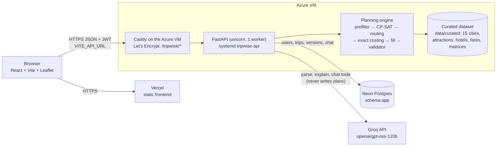

# Tripwise

Budget trip planner for 15 Indian cities. Course project 4 for UMC301 Applied Data Science and Artificial
Intelligence, built with spec-driven development (SDD).

Give Tripwise an origin, a destination, dates, a group size, a budget and your preferences. It returns two or three
trip plans (Saver, Balanced, Experience). Each covers transport there and back, a hotel, a day-by-day itinerary with
local rides, and a full budget breakdown with trade-offs. You can then refine the chosen plan in chat.

- **Optimisation engine** (OR-Tools): CP-SAT picks the transport, hotel and activities within the budget, routing
  schedules each day under opening hours and travel times, and a fill step adds anything that still fits. An
  independent validator checks every plan before it is shown, so every plan fits the budget, opening hours, travel
  times and daily limits.
- **AI assistant** (Groq `openai/gpt-oss-120b`): turns a free-text description into preferences, explains each plan,
  and turns chat messages into plan changes. It never writes or edits a plan: chat calls tools, the engine re-plans,
  and every name and ₹ amount in an AI reply is checked against the plan.

**Live:** https://tripwise-inky.vercel.app. The API is at
https://lekhya-audiobook.centralindia.cloudapp.azure.com/tripwise/health.

> Prices are estimates compiled from public sources for planning. They are not live quotes, and nothing in the app
> can be booked.

## Architecture



A chat message makes at most two Groq calls. Call 1 picks tools such as `set_budget` or `move_activity`. The API
turns them into a re-plan request, and the engine produces and validates the new version. Call 2 writes the reply
from the diff between versions, and the reply is grounded: every name and ₹ amount in it must come from the plan,
or a template is used instead.

## Repository layout

```
Project4/
├── SPEC.md          the single spec: constitution, product, features 001–008, traceability, changelog
├── CLAUDE.md        instructions for Claude Code
├── PRODUCT.md       product and design context (Impeccable)
├── datatools/       building the curated dataset (Feature 001)
├── data/curated/    the dataset the engine reads
├── backend/
│   ├── tripwise/    engine, variants, trade-offs, config.yaml (all tunables)
│   ├── validator/   independent plan checks V-01…V-16
│   ├── api/         FastAPI app, auth, trips, versions, AI layer (Features 004, 007)
│   └── tests/       pytest (engine, variants, API, AI)
├── frontend/        React app (Feature 006); Playwright tests in tests/ and tests-live/
├── eval/            test trips, baselines, run_eval.py, RESULTS.md, LIVE.md, AI acceptance write-ups
└── deploy/          systemd unit, Caddy block, redeploy script (Feature 008)
```

## Run locally (PowerShell)

Needs Python 3.11+, Node.js (built with 24) and a Neon (or any Postgres) database.

```powershell
cd C:\dev\Project4
Copy-Item .env.example .env                       # fill in DATABASE_URL, JWT_SECRET, GROQ_API_KEY
python -m venv backend\.venv
backend\.venv\Scripts\python.exe -m pip install -r backend\requirements.txt

# API on http://localhost:8000 (creates the schema on first start)
cd backend
.venv\Scripts\python.exe -m uvicorn api.main:app --reload --port 8000

# Web app on http://localhost:5173 (second terminal)
cd C:\dev\Project4\frontend
npm install
npm run dev
```

Tests:

```powershell
cd C:\dev\Project4\backend; .venv\Scripts\python.exe -m pytest -q        # engine, API (schema app_test), AI with a Groq stub
cd C:\dev\Project4\frontend; npx playwright test                         # UI acceptance tests at 360 and 1280 px, axe
npx playwright test -c playwright.live.config.ts                         # live full flow on the deployed site
```

## Environment variables

| Name | Where | Meaning |
|---|---|---|
| `DATABASE_URL` | API | Neon Postgres connection string (pooled) |
| `JWT_SECRET` | API | Long random string that signs login tokens |
| `GROQ_API_KEY` | API, eval | Groq key for the AI features; planning works without it |
| `FRONTEND_ORIGIN` | API | The only origin CORS allows in production (the Vercel URL) |
| `APP_ENV` | API | `development` also allows `http://localhost:5173`; `production` on the VM |
| `DB_SCHEMA` | API | Postgres schema for user data (default `app`; tests use `app_test`) |
| `ORS_API_KEY`, `OPENTRIPMAP_API_KEY` | datatools | Only for rebuilding the dataset (Feature 001) |
| `VITE_API_URL` | frontend build | API base URL (`frontend/.env.example`; on Vercel the VM's HTTPS URL) |

Secrets live in `.env` locally (never committed) and in `/etc/tripwise.env` (root, 600) on the VM. Tunable numbers
are in `backend/tripwise/config.yaml`.

## Deploy

- **Backend:** Azure VM, behind the Caddy that already serves Project 2 there. Set-up and details are in
  `deploy/README.md`. To redeploy the committed code, run `.\deploy\deploy.ps1`, which ships `git archive HEAD`,
  reinstalls requirements, restarts `tripwise-api` and checks `/health` over HTTPS.
- **Frontend:** Vercel CLI from `frontend/` (project `tripwise`, `frontend/vercel.json`):
  `npx vercel@latest deploy --prod --build-env VITE_API_URL=https://lekhya-audiobook.centralindia.cloudapp.azure.com/tripwise`.

## Evaluation

`python eval/run_eval.py` compares Tripwise with a greedy baseline on 30 test trips (26 feasible, 4 that must be
declined) and with an LLM-only planner on 10 of them. Every plan goes through the same validator. Full tables,
charts and discussion are in `eval/RESULTS.md`.

| Planner | Valid plans | Mean value | Mean budget use | Travel share of the day |
|---|---|---|---|---|
| Tripwise, all 30 trips | 26/26 feasible trips (100%); 4/4 infeasible trips declined | 729.5 | 72% | 16% |
| Greedy, all 30 trips | 26/26 (100%); 4/4 declined | 645.5 | 69% | 28% |
| Tripwise, same 10 trips | 10/10 | 715.0 | 73% | 13% |
| Greedy, same 10 trips | 10/10 | 620.9 | 69% | 27% |
| LLM-only, same 10 trips | 2/10 (20%) | 596.0 (2 plans) | 73% | 23% |

Tripwise scores 13% more value than greedy on average and spends 16% of the day on local rides against greedy's
28%; greedy still scores higher on 6 of the 26 trips. The LLM-only planner wrote a usable plan for only 2 of 10 trips:
the other 8 broke day-length, lunch, budget or attraction rules (V-10 and V-11 on 6 trips each), which the
validator caught. Tripwise shows 2.4 distinct variants per trip on average. Chat tool accuracy (AI-AT-03) is
45/50 = 90%.

Live, on the Azure VM: all variants p95 1.21 s over the 30 trips (limit 5 s). Chat p95 4.72 s and 7.41 s in two runs
of 10 messages (limit 8 s), with a per-message deadline: a slow Groq response gets a template reply, or "assistant
unavailable" if Groq is slow to choose the tool (1 of 20 messages). On the laptop the chat p95 is 7.0 s.

The AI and live checks are written up in `eval/AI_AT_01.md` to `eval/AI_AT_04.md` and `eval/LIVE.md`.

## How it was built (SDD)

Everything is specified in `SPEC.md`. Each feature (001 city data → 002 engine, variants and trade-offs → 004 accounts and API → 006 web app →
007 AI layer → 008 evaluation and deployment; 003, 005 and 009 were merged into neighbours) went through Spec, Plan, Tasks, Implement and Verify. Requirement IDs
appear in the commits, and Part D traces every requirement to its tests. When the code had to differ from the spec,
the spec was changed first and a Changelog row records why.

## Stack

React 18 (Vite, TypeScript, Tailwind, TanStack Query, react-leaflet, Recharts) on Vercel · Python FastAPI +
OR-Tools on an Azure VM · PostgreSQL on Neon · Groq · OpenStreetMap, OpenTripMap and OpenRouteService for the
geo data.
