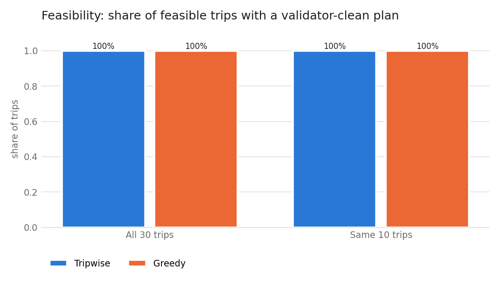
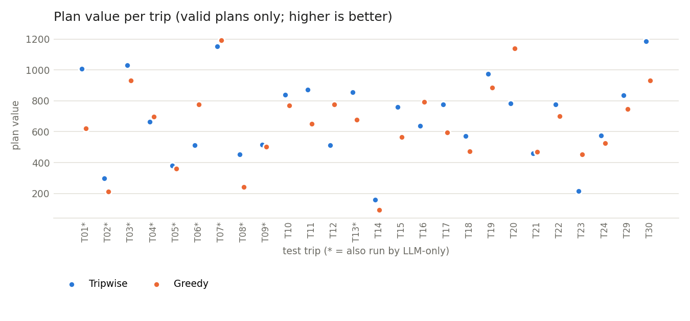
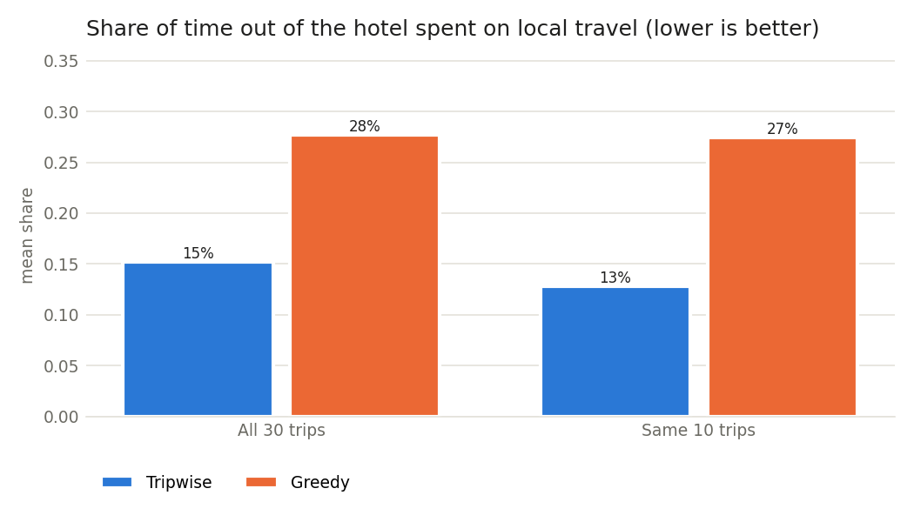

# Evaluation results (Feature 008)

Generated by `python eval/run_eval.py` on 2026-10-26 from `eval/test_trips.json` (30 trips: 26
feasible, 4 that must be reported infeasible). Raw rows: `eval/out/results.csv`. Charts: `eval/charts/feasibility.png`,
`eval/charts/value.png`, `eval/charts/travel_share.png`.

All three planners use the same data, time model, cost model and value function, and every plan is checked by the
same independent validator. "Tripwise" is the engine's single plan in the user's tier (`engine.plan`); "distinct
variants" counts the variants shown after the difference rule. Greedy and Tripwise run all 30 trips; LLM-only
(`openai/gpt-oss-120b`, one call per trip) runs 10 of them because of Groq free-tier limits: T01, T02, T03, T04, T05, T06, T07, T08, T09, T13.

Budget use is the plan cost ÷ usable budget; travel share is local-ride minutes ÷ minutes out of the hotel. Means are
over valid plans. Times: Tripwise and greedy on this laptop; LLM-only includes the Groq round trip.

## All 30 trips (Tripwise, greedy)

| Planner | Feasible trips with a valid plan | Failed plans | Violations (V-xx: trips) | Declined infeasible | Mean value | Total value | Mean budget use | Mean travel share | Median time | Distinct variants |
|---|---|---|---|---|---|---|---|---|---|---|
| Tripwise | 26/26 (100%) | 0 | none | 4/4 | 684.742 | 17803.3 | 72% | 15% | 170 ms | 2.538 |
| Greedy | 26/26 (100%) | 0 | none | 4/4 | 645.475 | 16782.4 | 69% | 28% | 6 ms | – |

## Same 10 trips (all three planners)

| Planner | Feasible trips with a valid plan | Failed plans | Violations (V-xx: trips) | Declined infeasible | Mean value | Total value | Mean budget use | Mean travel share | Median time | Distinct variants |
|---|---|---|---|---|---|---|---|---|---|---|
| Tripwise | 10/10 (100%) | 0 | none | – | 687.255 | 6872.5 | 72% | 13% | 236 ms | 2.6 |
| Greedy | 10/10 (100%) | 0 | none | – | 620.894 | 6208.9 | 69% | 27% | 6 ms | – |

## Discussion

- **Feasibility.** Tripwise returned a validator-clean plan for 26/26 feasible trips and
  correctly declined 4/4 infeasible ones. Greedy, built on the same time and cost functions, was
  also clean (26/26): feasibility comes from the shared model, not from the optimiser.
  LLM-only has not been run yet (`python eval/run_eval.py --llm`).
- **Value.** Tripwise's mean value is 684.742 against greedy's 645.475, but greedy scored higher on
  8 of 26 trips (T04, T06, T07, T12, T16, T20, T21, T23). On those trips greedy fits more activities (16.12 against
  12.88 on average) for about the same share of the budget (0.69 against 0.68): the engine selects
  activities in stage 1 on conservative estimates of time and cost and does not top up the plan after exact routing.
  Over all trips budget use is similar (0.716 against 0.693). A post-routing fill step
  is the clearest improvement to make next.
- **Travel.** Tripwise routes each day (OR-Tools), so a smaller share of the day goes on local rides
  (0.152 against greedy's 0.277).
- **Variants.** Tripwise showed 2.538 distinct variants per feasible trip on average.
- **Chat intents (EVAL-FR-03).** See AI-AT-03 in `eval/AI_AT_03.md`.
